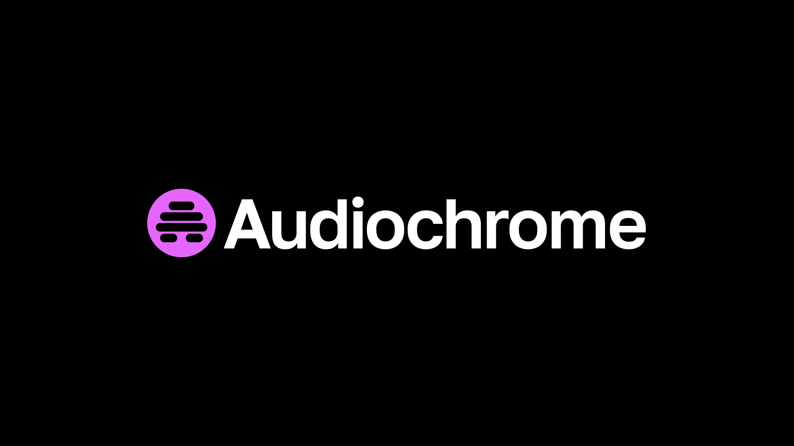
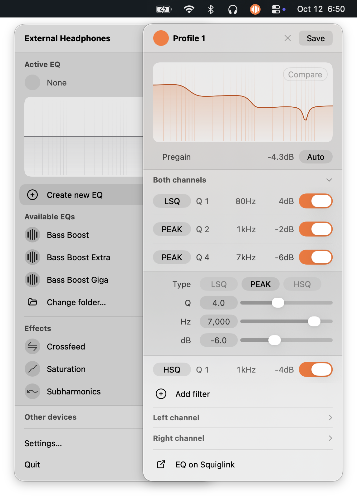

<p align="center">
  
</p>

- Lightweight system-wide parametric EQ for macOS
- Active EQ reminders. Never accidentally use EQ when you don't want to
- Per-device PEQ profile mapping
- Level-matched compare mode
- Simple interface for creating and editing PEQ profiles
- Drag-and-drop import PEQ profiles from Squiglink and other tools
- Support for separate left and right channel PEQ profiles
- Saturation, crossfeed, and subharmonics effects
- Disables cleanly. Doesn't touch system audio when Audiochrome is off

**[Download Audiochrome](https://github.com/MRSallee/Audiochrome/releases/latest/download/Audiochrome.zip)** ([1.7.5 version history](https://github.com/MRSallee/Audiochrome/releases))

<p align="center">
  
</p>

## Install

1. Download and unzip `Audiochrome.zip`.
2. Move `Audiochrome.app` to Applications and open it. Audiochrome lives in the menu bar.
3. Grant **System Audio Recording** when prompted. If EQ doesn’t start after allowing, choose Relaunch in the Audiochrome menu.
4. Select an output, turn EQ on, and pick a profile.
5. No driver installation required.

## Requirements

- macOS 14.2+ (Apple Silicon or Intel)
- **System Audio Recording** access when prompted (to process system audio)

Building from source also needs Swift 5.9+ and Xcode Command Line Tools (full Xcode optional).

## Build from source

```bash
# Parser / device smoke checks (no full Xcode / XCTest required)
swift run AudiochromeSmoke

# Local debug .app (ad-hoc sign)
./Scripts/package-app.sh debug

# Distributable release: Developer ID sign → notarize → staple → zip
./Scripts/package-app.sh release
open .build/Audiochrome.app
# Share: .build/Audiochrome-<version>.zip
```

Requires a **Developer ID Application** cert and `notarytool` profile `Audiochrome` (see `xcrun notarytool store-credentials`). Skip notarization with `SKIP_NOTARIZE=1`.

Or run the binary directly:

```bash
swift run Audiochrome
```

## Profiles

Place Equalizer APO / Squiglink `.txt` files in:

```text
~/Documents/Audiochrome/EQ profiles/
```

On first launch Audiochrome creates that folder and seeds a few starter profiles. Change Folder… on an output can point at any other directory. Config (per-device enable, profile, color) stays in:

```text
~/Library/Application Support/Audiochrome/config.json
```

Supported profile shapes:

- Linked stereo (no `Channel:` lines)
- Independent L/R (`Channel: L` / `Channel: R`)

## Architecture (current)

| Piece | Role |
|-------|------|
| `Audiochrome` | Status-item panel UI (AppKit + SwiftUI) |
| `AudiochromeCore` | Parser, config, devices, engine orchestration |
| `ProcessTapAudioEngine` | System-wide EQ via process tap + aggregate replay |
| `EQProcessor` | Parametric biquads (Squiglink / APO), L/R + preamp |
| `StubAudioEngine` | Fallback when process tap is unavailable |

## License

Source is published under the [PolyForm Noncommercial License 1.0.0](LICENSE) so you can use and inspect it for non-commercial purposes. Commercial use needs permission.

**Audiochrome** and its logo are trademarks. Forks and redistributions may not use the name or marks in a way that implies they are the official project.
